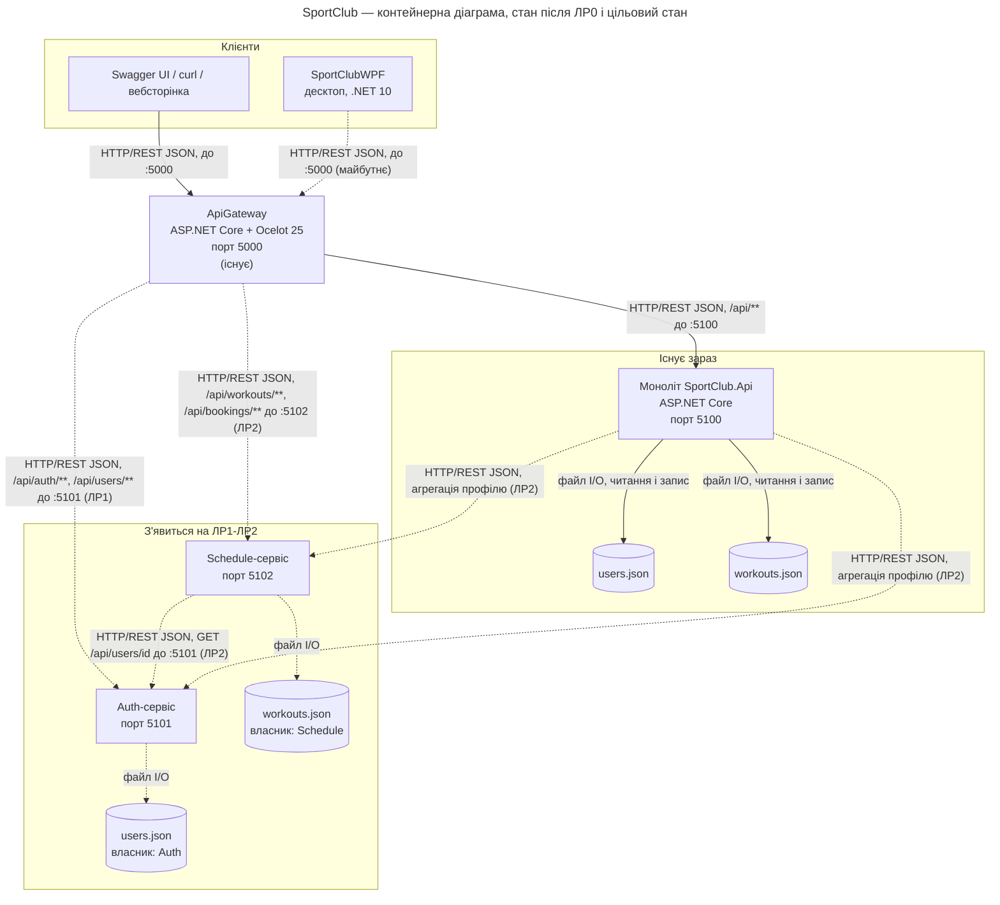

# Діаграма композиції (рівень Container моделі C4)

Система SportClub: що працює зараз (суцільні лінії) і що з'явиться на ЛР1–ЛР2 (пунктир).

## Легенда

| Позначення | Значення |
|---|---|
| Суцільна стрілка | зв'язок працює вже після ЛР0 |
| Пунктирна стрілка | зв'язок з'явиться на ЛР1–ЛР2 |
| Прямокутник | окремий процес (контейнер за C4) із зазначеним портом |
| Циліндр | сховище даних; у цьому проєкті це JSON-файли, а не СУБД |
| Підпис на стрілці | протокол, формат і порт отримувача |

Десктопний `SportClubWPF` наразі працює з бібліотекою напряму і з файлами локально; перехід
на HTTP через шлюз показано пунктиром як майбутній крок.
