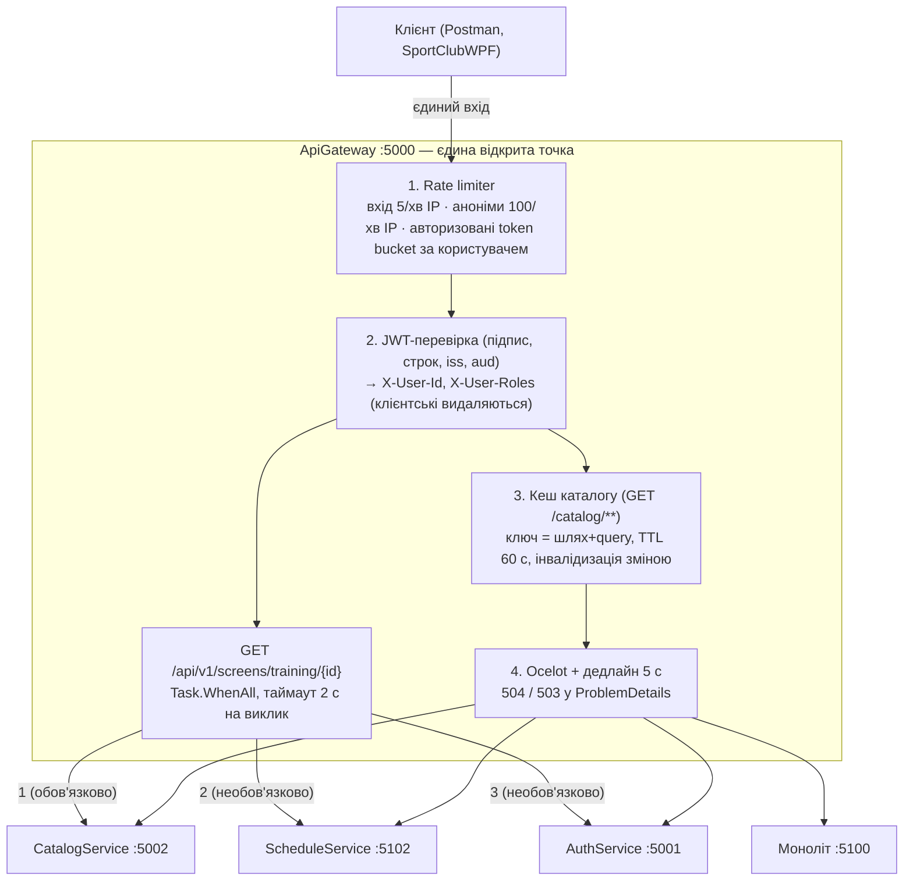
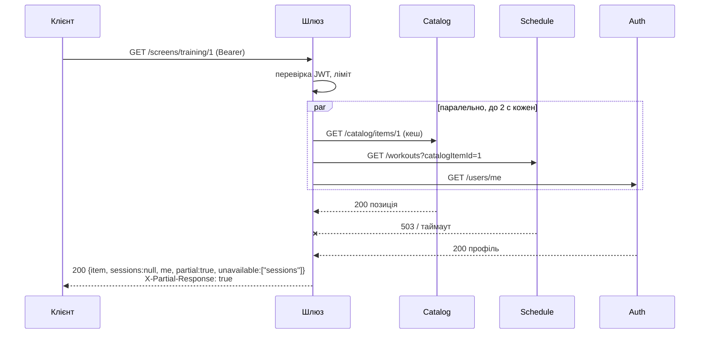

# Діаграма після ЛР3: складений запит, автентифікація, кеш, ліміти

**Читати так.** Порти 5001/5002/5100/5102 у docker-compose назовні **не публікуються** — до сервісів можна дістатися лише через шлюз.

## Складений запит: послідовність і часткова відповідь

